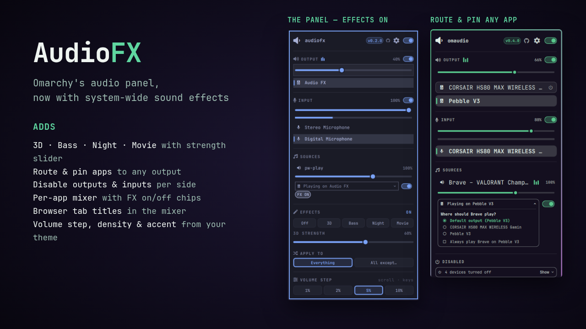
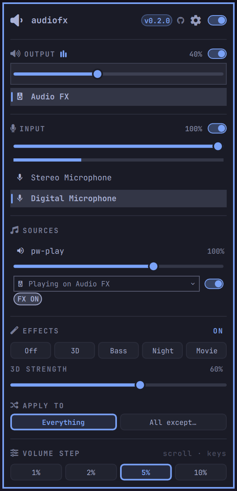
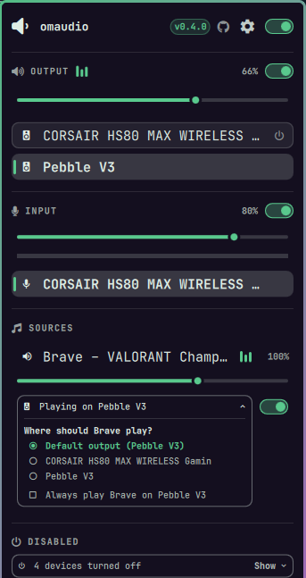

# Audio FX



Omarchy's audio panel, with the controls it was missing — plus system-wide
sound effects. Drop-in replacement. Follows Omarchy themes.

<p>
  
  
</p>

A drop-in replacement for the built-in `omarchy.audio` bar widget. Everything
the stock panel does still works the same way — volume, output and input
pickers, the per-app mixer, keyboard navigation — and it adds:

- **Sound effects.** An EFFECTS section: **Off**, **3D** (binaural surround
  for headphones), **Bass**, **Night** and **Movie** presets with a strength
  slider, applied system-wide on a PipeWire filter-chain — no config-file
  editing. Effects can cover **Everything**, or **All except…** chosen apps
  (games go direct); each app row gets an **FX ON / FX OFF** chip.
- **Disable devices.** Hover an output or input and click the power icon (or
  press `d`). Disabled devices collect in a **Disabled** section at the bottom,
  folded into one line ("4 devices turned off"). Click **Show** to list them,
  then click one to turn it back on. Nothing else is interrupted. Bluetooth
  devices carry a Bluetooth mark and can be disabled too.
- **Mute one side.** OUTPUT and INPUT each have their own switch; the one in
  the header still mutes both.
- **Choose where each app plays.** Under every app in the mixer, a
  "Playing on..." field shows its output. Click it to pick another
  (or press `r` to step through outputs). The switch beside it mutes the app.
- **Pin an app to an output.** In that picker, tick **Always play Brave on...** —
  the output you picked, or the one it is playing on. Every new Brave stream
  goes there. If the output disappears, Brave falls back to the default and
  moves back when the output returns.
- **Tell browser tabs apart.** Chromium-based browsers name every stream
  "Playback". When it can tell for certain, the mixer shows the tab instead:
  "Brave – VIDEO/AUDIO titles". Otherwise it numbers them: "Brave · 1 of 2".
- **See what is playing.** Small equalizer bars move next to OUTPUT and beside
  each app that is making sound, in your theme's accent colour.
- **Pick the volume step.** 1%, 2%, 5% or 10% per scroll notch on the bar icon,
  per slider step and per `h`/`l` in the panel.
- **Make it yours.** The ⚙ in the header opens its settings: a **Compact**,
  **Normal** or **Comfortable** layout, font size, an accent colour (the
  theme's own, or any colour from its palette), and switches to hide any
  section — playing bars, mute switches, the routing fields, the Disabled
  section, the effects section, the header info or the step footer.

Changing the default output also leaves apps you routed or pinned where they
are, instead of moving every stream to the new default.

## Install

```bash
omarchy plugin add https://github.com/gdeyoung/omarchy-audiofx.git --enable --yes
```

It declares itself a replacement for `omarchy.audio`: it takes the stock
audio widget's place in the bar, and `Super+Ctrl+A` and other callers of the
built-in panel open this one.

Needs Omarchy 4+, plus `pactl`, `pw-metadata` and `jq` (all present on a
standard install).

### The effects engine

The EFFECTS section drives a separate engine: a virtual PipeWire sink
(`gdy_audiofx`) hosted by its own systemd user units (`audiofx.service`,
`audiofx-watch.service`), so preset switches restart only that client —
never the PipeWire daemon — and Spotify/browsers/Steam keep their
connections. The panel reaches the engine only through this plugin's
`fx-*` commands, via the executable at `~/.local/bin/audiofx`. Without the
engine the panel works normally and the EFFECTS section reports the failure.
With it, the physical sink stays hidden from the device list while effects
are active (selecting it would bypass them), and volume keys resolve through
the FX sink to the real device.

The engine (`audiofx.py`, `irgen.py` — MIT, python-numpy) is a sibling
component: [gdeyoung/audiofx-engine](https://github.com/gdeyoung/audiofx-engine).

```bash
git clone https://github.com/gdeyoung/audiofx-engine ~/audiofx-engine
mkdir -p ~/.local/bin && ln -s ~/audiofx-engine/audiofx.py ~/.local/bin/audiofx
audiofx apply '{"spatial":60,"bass":50,"night":0}'   # first apply enables its units
```

### Volume keys (optional)

The volume keys, and headset or keyboard volume wheels that send them, are
bound by Omarchy to a fixed 5%. To have them follow the panel's volume step,
add this to `~/.config/hypr/bindings.lua`:

```lua
local audiofx = os.getenv("HOME") .. "/.config/omarchy/plugins/gdeyoung.audiofx/bin/audiofx"
hl.unbind("XF86AudioRaiseVolume")
hl.unbind("XF86AudioLowerVolume")
o.bind("XF86AudioRaiseVolume", "Volume up", audiofx .. " volume up", { locked = true, repeating = true })
o.bind("XF86AudioLowerVolume", "Volume down", audiofx .. " volume down", { locked = true, repeating = true })
```

### Update

```bash
omarchy plugin update gdeyoung.audiofx
omarchy restart shell
```

### Uninstall

Turn disabled devices back on first (disabling switches a device's card
profile, which WirePlumber keeps after the plugin is gone), and run
`audiofx off` to remove the effects sink. Then:

```bash
omarchy plugin remove gdeyoung.audiofx
```

The stock audio widget returns to its place in the bar. Pins are kept in
`~/.local/state/audiofx/` and can be deleted.

## Settings

Everything here is also in the panel's ⚙ settings view, which saves as you
click. From a terminal:

| Key | Default | Meaning |
| --- | --- | --- |
| `density` | `"normal"` | `"compact"`, `"normal"` or `"comfortable"` |
| `accent` | `"theme"` | `"theme"` or `"blue"`, `"cyan"`, `"green"`, `"magenta"`, `"yellow"`, `"red"`, `"orange"` (from the theme's palette) |
| `fontSize` | `"normal"` | `"small"`, `"normal"` or `"large"`, on top of density |
| `scrollStep` | `5` | Volume step in percent (1–25) |
| `showPlayingBars` | `true` | Equalizer bars next to OUTPUT and each playing app |
| `showSectionMutes` | `true` | Mute switches beside OUTPUT and INPUT |
| `showRouting` | `true` | The "Playing on …" output field under each app |
| `showDisabled` | `true` | The Disabled devices section |
| `showHeaderInfo` | `true` | The version and GitHub link in the header |
| `showStepFooter` | `true` | The volume step footer |
| `showFxSection` | `true` | The effects section |

```bash
omarchy bar set gdeyoung.audiofx density '"compact"' --json
omarchy bar set gdeyoung.audiofx scrollStep 2 --json
omarchy bar set gdeyoung.audiofx showFxSection false --json
```

## How it works

The panel is Omarchy's stock `Panel.qml` and `Model.js`, extended (via the
omaudiopanel fork below). The system side lives in `bin/audiofx`, a small
script the panel calls:

- **Disabling** switches only that device's card profile — for example from
  `output:analog-stereo+input:mono-fallback` to `output:analog-stereo` to
  drop a headset's microphone, or to `off` when nothing is left. WirePlumber
  remembers the profile across reboots. No service is restarted.
- **Routing** sets `target.object` for the stream in PipeWire's default
  metadata. WirePlumber follows it, falls back to the default output when the
  target is missing, and relinks when it returns.
- **Pins** are kept in `~/.local/state/audiofx/pins`. The panel applies them
  whenever a stream or output appears, whether or not it is open. Streams you
  route by hand are left alone; routes a pin creates are marked in the
  stream's own PipeWire metadata, and removing a pin undoes only those.
- **Tab titles** come from the MPRIS players browsers publish per tab, matched
  only when certain.
- **Effects** — `fx-status`, `fx-apply`, `fx-rules` — delegate to the engine
  executable and are unit-tested against a stub. Effects compose as
  `[ 3D convolver bank ] -> [ bass IR ] -> [ night IR ]`: bass and night
  regenerate their impulse response per strength, 3D is a wet/dry blend.
  Apply is transactional: config render → unit restart → sink-present check,
  with rollback to the previous default sink on failure.
- **Mute writes go to both ends of the chain.** With effects active the
  panel resolves the physical device the chain feeds (the same definition
  the volume keys use), and a mute or unmute sets both that device and the
  FX sink — so a switch can never flip one end while the other stays wedged.
  The engine's guardian keeps the FX sink pinned as plumbing regardless; see
  the [engine's mute-authority docs](https://github.com/gdeyoung/audiofx-engine#mute--volume-authority).

### What the plugin runs

| Command | Purpose |
| --- | --- |
| `pactl`, `wpctl` | list devices/streams, card profiles, default sink |
| `pw-metadata` | per-stream routing and pin markers |
| `jq` | parse the above |
| `omarchy-audio-output-volume` | the volume-key step |
| `~/.local/bin/audiofx` (engine) | status / apply preset / routing rules |

## Troubleshooting

**No sound, or no mic input?** Run the engine's audit first — it prints the
whole audio tree and names the exact wedge:

```sh
audiofx doctor
```

It exits non-zero with a plain-English fault when audio is playing into a
muted device, when the effects sink has been tampered with, or when the
microphone is muted (dead dictation/calls). On a healthy system it prints
the full state and exits 0. Details and the fault table:
[audiofx-engine → Troubleshooting](https://github.com/gdeyoung/audiofx-engine#troubleshooting).

## Limits

- Turning off one side of a device that is in use switches that device's
  profile, so its audio may glitch for a moment. Other devices are unaffected.
- Bluetooth profiles are not split into output and input parts, so disabling
  either side of a Bluetooth device turns it off.
- A stream moved with another tool (pavucontrol, `wpctl`) keeps its pin mark.
- Routing covers playback. Recording apps are not listed, as in the stock panel.
- The effects section is mouse-driven (pills, slider, chips); `j/k` keyboard
  navigation covers the stock sections.
- Games under Wine often open several unnamed streams ("audio stream #1",
  "#3"); they show as numbered rows, and a pin covers all of them.

## Development

```bash
npm test
```

Runs the `Model.js` unit tests with `node --test` and the helper tests, which
drive `bin/audiofx` against stubbed `pactl`, `pw-metadata` and engine.

The shell keeps a loaded plugin's QML cached; after editing, run
`omarchy restart shell` to see changes.

## Credits

Forked from [thevideinfra/omaudiopanel](https://github.com/thevideinfra/omaudiopanel)
(MIT) — device disabling, per-app routing, pins, tab titles, settings — which
itself extends Omarchy's `omarchy.audio` panel by 37signals/Basecamp (MIT).
Effects engine: `audiofx` (gdeyoung), building on the HeSuVi HRIR bundle
fetched at runtime from the GPL-3.0 Arctis-Sound-Manager project (not
redistributed here).

## License

MIT — see [LICENSE](LICENSE).
